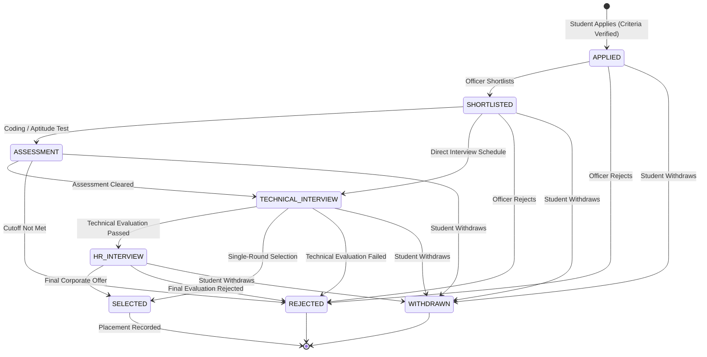

# Placera System Architecture Document

## 1. High-Level Architecture Overview

Placera is designed as a cloud-native modular monolith for the backend and a decoupled single-page application (SPA) for the frontend.

```mermaid
graph TD
    subgraph Client ["Client Layer"]
        Browser["User Browser (Student / Admin)"]
    end

    subgraph CDN ["Frontend Hosting"]
        SWA["Azure Static Web Apps / Nginx Container<br/>(React + Vite + TypeScript)"]
    end

    subgraph BackendServices ["Backend Compute"]
        ACA["Azure Container Apps / Docker Container<br/>(Spring Boot 3.3 • Java 21)"]
        Actuator["Spring Boot Actuator<br/>(/actuator/health, metrics)"]
        Security["Spring Security 6<br/>(JWT + BCrypt + RBAC)"]
    end

    subgraph DataStorage ["Data & Storage Layer"]
        PG[("PostgreSQL 16 Database<br/>Flyway Migrations")]
        Blob[("Azure Blob Storage / Local Volume<br/>Private Resumes")]
    end

    subgraph Observability ["Observability"]
        AppInsights["Azure Application Insights / Prometheus"]
        LogAnalytics["Azure Log Analytics Workspace"]
    end

    Browser -->|HTTPS / Static Assets| SWA
    Browser -->|REST API Requests (JWT)| ACA
    ACA --> Security
    ACA --> Actuator
    ACA -->|Connection Pool (HikariCP)| PG
    ACA -->|Private Document Access| Blob
    ACA -->|Telemetry & Metrics| AppInsights
    AppInsights --> LogAnalytics
```

---

## 2. Component Design

### 2.1 Frontend Architecture (React 18 + Vite + TypeScript)
- **State Management & Context**: `AuthContext` maintains session tokens, user metadata, and role permissions. `ToastContext` handles non-intrusive notifications.
- **Routing & Route Guards**: React Router v6 with `ProtectedRoute` component enforcing role-based client-side redirection (`/student/*` vs `/admin/*`).
- **HTTP Client**: Axios with request/response interceptors automatically attaching Bearer tokens and gracefully intercepting session expirations.
- **Design System**: Tailored Placera aesthetic utilizing deep navy (`#0B192C`), electric blue (`#008DDA`), and slate surfaces (`#F8FAFC`).

### 2.2 Backend Architecture (Spring Boot 3.3 + Java 21)
- **Layered Architecture**: Strict separation of concerns between `controller`, `service`, `repository`, `entity`, `dto`, and `security`. Controllers contain zero business logic.
- **Authentication**: Stateless HMAC-SHA256 JWT tokens with support for both `Authorization: Bearer <token>` headers and secure HttpOnly cookies.
- **Data Access**: Spring Data JPA with Flyway database migration tracking, composite indexes, and eager joins to eliminate N+1 query performance degradation.
- **File Management**: `ResumeStorageService` abstraction supporting local file storage during development and Azure Blob Storage in production with strict PDF file header verification.

---

## 3. Recruitment State Machine Lifecycle


