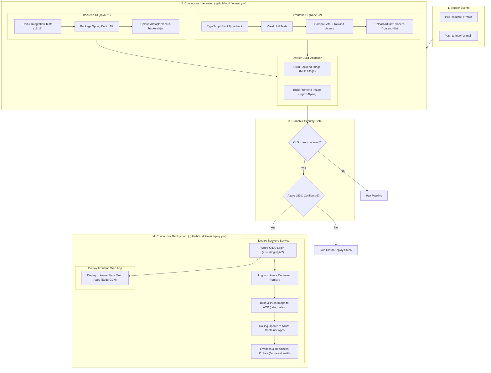

# Placera CI/CD Pipeline & Azure Deployment Architecture Guide

## 1. Overview & Pipeline Architecture

Placera features an enterprise-grade, decoupled Continuous Integration (CI) and Continuous Deployment (CD) pipeline utilizing **GitHub Actions**, **Docker Buildx**, **OpenID Connect (OIDC)** authentication, **Azure Container Registry (ACR)**, **Azure Container Apps (ACA)**, and **Azure Static Web Apps (SWA)**.



---

## 2. Design Principles & Hard Constraints

1. **Strict Credential Independence in CI**:
   - The CI pipeline (`ci.yml`) has **zero dependency on Azure credentials**.
   - It runs against any pull request, fork, or branch without requiring access to cloud secrets or billing accounts.
2. **Gated Deployment on Approved Branch**:
   - The deployment pipeline (`deploy.yml`) is triggered via `workflow_run` only when the CI workflow completes with a `success` conclusion on the `main` branch (or via authorized manual `workflow_dispatch`).
3. **Passwordless Cloud Authentication (Azure OIDC)**:
   - Uses GitHub Actions OpenID Connect (OIDC) federation with Microsoft Entra ID (formerly Azure Active Directory).
   - No long-lived client secrets, management certificates, or cloud passwords are stored in GitHub.
4. **Least-Privilege GitHub Permissions**:
   - CI workflow enforces `permissions: contents: read`.
   - Deployment workflow enforces `permissions: contents: read, id-token: write` (strictly scoped for OIDC token minting).
5. **Zero Out-of-Pocket Spending Guard**:
   - Azure Container Apps is configured with `min_replicas = 0`, ensuring that the container scales to 0 instances when idle, incurring $0 compute charges during inactive periods.

---

## 3. GitHub Configuration: Secrets and Variables Reference

Configure these settings under **GitHub Repository -> Settings -> Secrets and variables -> Actions**:

### 3.1 Repository Variables (Non-Sensitive Configuration)
Go to **Variables** tab -> **New repository variable**:

| Variable Name | Description | Example Value |
| :--- | :--- | :--- |
| `AZURE_CLIENT_ID` | Application (client) ID of the Entra ID App Registration | `11111111-2222-3333-4444-555555555555` |
| `AZURE_TENANT_ID` | Directory (tenant) ID of your Azure Active Directory | `aaaaaaaa-bbbb-cccc-dddd-eeeeeeeeeeee` |
| `AZURE_SUBSCRIPTION_ID` | Azure Subscription ID containing the resources | `xxxxxxxx-yyyy-zzzz-wwww-vvvvvvvvvvvv` |
| `AZURE_RESOURCE_GROUP` | Name of the provisioned Azure Resource Group | `rg-placera-prod` |
| `AZURE_CONTAINER_REGISTRY` | Name of the Azure Container Registry (alphanumeric only) | `crplaceraprod` |
| `AZURE_CONTAINER_APP_NAME` | Name of the backend Azure Container App | `ca-placera-backend-prod` |

### 3.2 Repository Secrets (Sensitive Credentials)
Go to **Secrets** tab -> **New repository secret**:

| Secret Name | Description | Source |
| :--- | :--- | :--- |
| `AZURE_STATIC_WEB_APPS_API_TOKEN` | Deployment token for Azure Static Web Apps | Run: `az staticwebapp secrets list --name swa-placera-prod --query properties.apiKey -o tsv` |

---

## 4. Exact Azure Setup Steps (One-Time Setup)

Execute these steps using the Azure CLI (`az`) on your machine:

### Step 1: Create the Azure Resource Group
```bash
az group create --name rg-placera-prod --location centralindia
```

### Step 2: Create Microsoft Entra ID App Registration for GitHub OIDC
```bash
# 1. Create the App Registration
APP_NAME="placera-github-oidc"
AZURE_CLIENT_ID=$(az ad app create --display-name "$APP_NAME" --query appId -o tsv)

# 2. Create the associated Service Principal
az ad sp create --id "$AZURE_CLIENT_ID"

# 3. Retrieve Tenant and Subscription IDs
AZURE_TENANT_ID=$(az account show --query tenantId -o tsv)
AZURE_SUBSCRIPTION_ID=$(az account show --query id -o tsv)
```

### Step 3: Configure Federated Identity Credentials for GitHub Actions
Federated credentials establish the trust relationship between your GitHub repository and Azure:

```bash
GITHUB_ORG="your-github-username-or-org"
GITHUB_REPO="Placera"

# Trust the 'main' branch of your repository
az ad app federated-credential create --id "$AZURE_CLIENT_ID" --parameters '{
  "name": "placera-github-main",
  "issuer": "https://token.actions.githubusercontent.com",
  "subject": "repo:'"$GITHUB_ORG"'/'"$GITHUB_REPO"':ref:refs/heads/main",
  "description": "Placera GitHub Actions OIDC deployment on main branch",
  "audiences": ["api://AzureADTokenExchange"]
}'
```

### Step 4: Grant Role Permissions to the Service Principal
Grant the Service Principal the necessary permissions on your resource group:

```bash
# Assign Contributor role on the resource group
az role assignment create \
  --role "Contributor" \
  --assignee "$AZURE_CLIENT_ID" \
  --scope "/subscriptions/$AZURE_SUBSCRIPTION_ID/resourceGroups/rg-placera-prod"

# Assign AcrPush role so the Service Principal can upload Docker images
ACR_RESOURCE_ID=$(az acr show --name crplaceraprod --resource-group rg-placera-prod --query id -o tsv)
az role assignment create \
  --role "AcrPush" \
  --assignee "$AZURE_CLIENT_ID" \
  --scope "$ACR_RESOURCE_ID"
```

### Step 5: Provision Cloud Infrastructure with Terraform
```bash
cd infra/terraform
cp terraform.tfvars.example terraform.tfvars
terraform init
terraform plan -out=tfplan
# Review plan and apply:
terraform apply tfplan
```

### Step 6: Retrieve Frontend Static Web App Deployment Token
```bash
az staticwebapp secrets list \
  --name "swa-placera-prod" \
  --resource-group "rg-placera-prod" \
  --query "properties.apiKey" -o tsv
```
Copy this token into GitHub Repository Secret: `AZURE_STATIC_WEB_APPS_API_TOKEN`.

---

## 5. Branch Protection Recommendations

To prevent broken code from ever reaching production, configure branch protection for `main` in **GitHub -> Settings -> Branches -> Add branch ruleset / protection rule**:

1. **Branch name pattern**: `main`
2. **Require a pull request before merging**: Yes
3. **Require status checks to pass before merging**: Yes
   - Check: `Backend Build & Test (Java 21)`
   - Check: `Frontend Typecheck, Tests & Build (Node 22)`
   - Check: `Docker Image Build Validation`
4. **Require branches to be up to date before merging**: Yes

---

## 6. Pre-Deployment Approval Checklist

Before triggering your first remote deployment or pushing to a live Azure environment:

- [ ] **Cost Verification**: Confirm all provisioned resources use student/free tier (ACA consumption, SWA Free, ACR Basic, scale-to-zero enabled).
- [ ] **OIDC Federation**: Confirm the federated credential in Entra ID matches your exact GitHub username/repo and branch (`refs/heads/main`).
- [ ] **GitHub Secrets & Variables**: Verify that all 6 variables and 1 secret are populated without extraneous whitespace or quotation marks.
- [ ] **Local Verification**: Ensure that `mvn clean test` and `npm run typecheck && npm test && npm run build` pass 100% locally.
