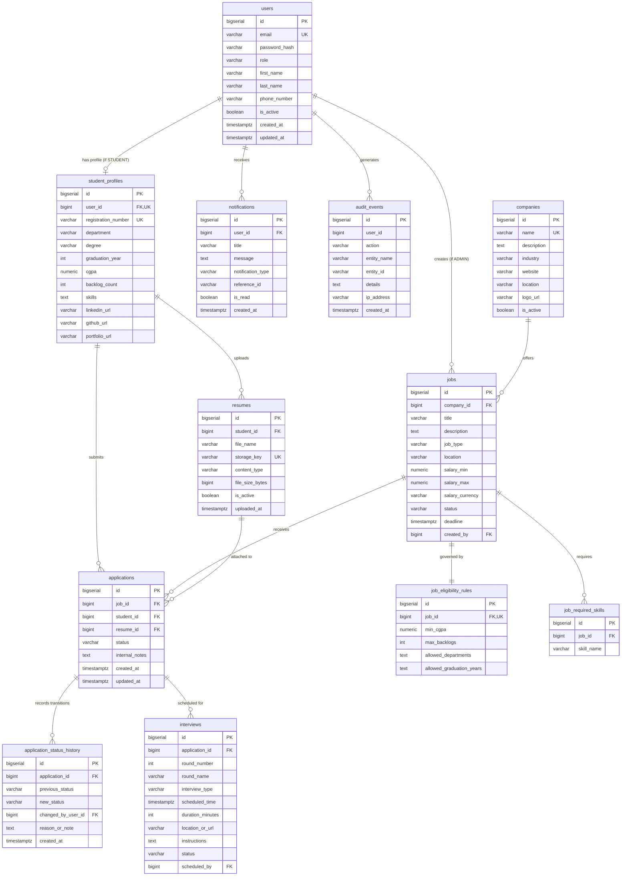

# Placera Database Design Document

## 1. Overview

Placera uses **PostgreSQL 16** as its relational database. Schema evolution is managed deterministically via **Flyway** migrations located under `backend/src/main/resources/db/migration/`.

### Core Design Principles:
1. **Strict Referential Integrity**: Strong foreign key relationships ensure that orphaned records (such as applications without student profiles or interviews without applications) cannot exist.
2. **Deterministic Versioning**: Flyway migrations guarantee reproducible schemas across local Docker Compose environments and Azure Database for PostgreSQL Flexible Servers.
3. **Comprehensive Indexing**: Strategic single and composite B-tree indexes optimize high-volume queries such as applicant filtering, unread notification counts, and eligibility searches.
4. **Auditability & Traceability**: All critical operational actions (application status transitions, student updates, job creations) are captured in dedicated append-only history and audit tables.

---

## 2. Entity-Relationship Diagram (ERD)

---

## 3. Detailed Table Specifications

### 3.1 `users`
Central identity store for students, administrators, and optional recruiters.
- `id` (BIGSERIAL, Primary Key): Unique surrogate identifier.
- `email` (VARCHAR(255), UNIQUE, NOT NULL): Institutional email address.
- `password_hash` (VARCHAR(255), NOT NULL): BCrypt hash (12 work factor rounds).
- `role` (VARCHAR(50), NOT NULL): `STUDENT`, `ADMIN`, `RECRUITER`.
- `first_name` (VARCHAR(100), NOT NULL): Legal first name.
- `last_name` (VARCHAR(100), NOT NULL): Legal last name.
- `phone_number` (VARCHAR(25), NULL): Contact phone number.
- `is_active` (BOOLEAN, DEFAULT TRUE): Soft-delete flag for account suspension.
- `created_at`, `updated_at` (TIMESTAMPTZ, DEFAULT CURRENT_TIMESTAMP): Audit timestamps.

### 3.2 `student_profiles`
Academic records and portfolio links for registered students.
- `id` (BIGSERIAL, Primary Key).
- `user_id` (BIGINT, UNIQUE, NOT NULL): 1-to-1 relationship with `users` (`ON DELETE CASCADE`).
- `registration_number` (VARCHAR(50), UNIQUE, NOT NULL): Campus roll number (e.g. `CS2022045`).
- `department` (VARCHAR(100), NOT NULL): E.g. `Computer Science and Engineering`.
- `degree` (VARCHAR(100), NOT NULL): E.g. `B.Tech`, `M.Tech`, `MCA`.
- `graduation_year` (INT, NOT NULL): Batch year (e.g. `2025`).
- `cgpa` (NUMERIC(4, 2), NOT NULL): Cumulative Grade Point Average (`0.00` to `10.00`).
- `backlog_count` (INT, NOT NULL, DEFAULT 0): Active backlogs count (`>= 0`).
- `skills` (TEXT, NULL): Comma-separated list of technical proficiencies.
- `linkedin_url`, `github_url`, `portfolio_url` (VARCHAR(500), NULL): Profile links.

### 3.3 `resumes`
Metadata tracking resumes stored securely in Azure Blob Storage or local volume.
- `id` (BIGSERIAL, Primary Key).
- `student_id` (BIGINT, NOT NULL): References `student_profiles(id)` (`ON DELETE CASCADE`).
- `file_name` (VARCHAR(255), NOT NULL): Sanitized client filename.
- `storage_key` (VARCHAR(255), UNIQUE, NOT NULL): Cryptographically random UUID filename.
- `content_type` (VARCHAR(100), NOT NULL): Enforced `application/pdf`.
- `file_size_bytes` (BIGINT, NOT NULL): Enforced `<= 5,242,880` (5MB).
- `is_active` (BOOLEAN, DEFAULT TRUE): Active resume flag.
- `uploaded_at` (TIMESTAMPTZ, DEFAULT CURRENT_TIMESTAMP).

### 3.4 `companies`
Corporate recruitment partner directory.
- `id` (BIGSERIAL, Primary Key).
- `name` (VARCHAR(255), UNIQUE, NOT NULL): Corporate legal entity name.
- `description` (TEXT, NULL): Overview and core business lines.
- `industry` (VARCHAR(100), NOT NULL): E.g. `Technology & Cloud Services`, `FinTech`.
- `website`, `location`, `logo_url` (VARCHAR, NULL).
- `is_active` (BOOLEAN, DEFAULT TRUE): Status indicator.

### 3.5 `jobs`
Placement openings posted by placement officers or recruiters.
- `id` (BIGSERIAL, Primary Key).
- `company_id` (BIGINT, NOT NULL): References `companies(id)` (`ON DELETE RESTRICT`).
- `title` (VARCHAR(255), NOT NULL): E.g. `Senior Cloud Systems Engineer`.
- `description` (TEXT, NOT NULL): Job description, responsibilities, and perquisites.
- `job_type` (VARCHAR(50), NOT NULL): `FULL_TIME`, `INTERNSHIP`, `INTERN_TO_FULL_TIME`.
- `location` (VARCHAR(255), NOT NULL): City, hybrid, or remote specifier.
- `salary_min`, `salary_max` (NUMERIC(12, 2), NULL): Compensation bracket.
- `salary_currency` (VARCHAR(10), DEFAULT 'INR').
- `status` (VARCHAR(50), NOT NULL): `DRAFT`, `PUBLISHED`, `CLOSED`, `ARCHIVED`.
- `deadline` (TIMESTAMPTZ, NOT NULL): Application cutoff timestamp.
- `created_by` (BIGINT, FK): Administrative user who posted the opening.

### 3.6 `job_eligibility_rules`
Fine-grained academic cutoffs applied server-side before application submission.
- `id` (BIGSERIAL, Primary Key).
- `job_id` (BIGINT, UNIQUE, NOT NULL): 1-to-1 with `jobs` (`ON DELETE CASCADE`).
- `min_cgpa` (NUMERIC(4, 2), DEFAULT 0.00): Minimum CGPA threshold.
- `max_backlogs` (INT, DEFAULT 0): Permissible standing backlogs.
- `allowed_departments` (TEXT, NOT NULL): Comma-delimited list of eligible academic departments.
- `allowed_graduation_years` (TEXT, NOT NULL): Comma-delimited list of eligible graduation years.

### 3.7 `job_required_skills`
Normalized list of mandatory or desired competencies for a job opening.
- `id` (BIGSERIAL, Primary Key).
- `job_id` (BIGINT, NOT NULL): References `jobs(id)` (`ON DELETE CASCADE`).
- `skill_name` (VARCHAR(100), NOT NULL).

### 3.8 `applications`
Recruitment workflow records connecting students with job openings.
- `id` (BIGSERIAL, Primary Key).
- `job_id` (BIGINT, NOT NULL): References `jobs(id)` (`ON DELETE RESTRICT`).
- `student_id` (BIGINT, NOT NULL): References `student_profiles(id)` (`ON DELETE RESTRICT`).
- `resume_id` (BIGINT, NULL): References `resumes(id)` (`ON DELETE SET NULL`).
- `status` (VARCHAR(50), NOT NULL, DEFAULT 'APPLIED'): Current stage in recruitment pipeline.
- `internal_notes` (TEXT, NULL): Confidential administrative evaluation notes.
- **Unique Constraint (`uk_job_student`)**: Composite unique constraint on `(job_id, student_id)` prevents race conditions and accidental duplicate submissions.

### 3.9 `application_status_history`
Append-only audit trail tracking every stage advancement or rejection.
- `id` (BIGSERIAL, Primary Key).
- `application_id` (BIGINT, NOT NULL): References `applications(id)` (`ON DELETE CASCADE`).
- `previous_status` (VARCHAR(50), NULL).
- `new_status` (VARCHAR(50), NOT NULL).
- `changed_by_user_id` (BIGINT, NULL): Admin or student who triggered the state transition.
- `reason_or_note` (TEXT, NULL): Explanation or round notes.
- `created_at` (TIMESTAMPTZ, DEFAULT CURRENT_TIMESTAMP).

### 3.10 `interviews`
Scheduled technical assessments and interview rounds.
- `id` (BIGSERIAL, Primary Key).
- `application_id` (BIGINT, NOT NULL): References `applications(id)` (`ON DELETE CASCADE`).
- `round_number` (INT, NOT NULL, DEFAULT 1).
- `round_name` (VARCHAR(100), NOT NULL): E.g. `Technical Architecture & Algorithms`.
- `interview_type` (VARCHAR(50), NOT NULL): `VIRTUAL`, `IN_PERSON`, `ASSESSMENT`.
- `scheduled_time` (TIMESTAMPTZ, NOT NULL): Absolute interview timestamp.
- `duration_minutes` (INT, NOT NULL, DEFAULT 45).
- `location_or_url` (VARCHAR(500), NULL): Virtual meeting link or campus room.
- `instructions` (TEXT, NULL).
- `status` (VARCHAR(50), DEFAULT 'SCHEDULED'): `SCHEDULED`, `COMPLETED`, `CANCELLED`, `RESCHEDULED`.
- `scheduled_by` (BIGINT, FK): Administrative user.

### 3.11 `notifications`
Targeted real-time notices for students and administrators.
- `id` (BIGSERIAL, Primary Key).
- `user_id` (BIGINT, NOT NULL): References `users(id)` (`ON DELETE CASCADE`).
- `title` (VARCHAR(255), NOT NULL).
- `message` (TEXT, NOT NULL).
- `notification_type` (VARCHAR(50), NOT NULL): `APPLICATION_UPDATE`, `INTERVIEW_SCHEDULED`, `JOB_ALERT`, `SYSTEM`.
- `reference_id` (VARCHAR(100), NULL).
- `is_read` (BOOLEAN, DEFAULT FALSE).
- `created_at` (TIMESTAMPTZ, DEFAULT CURRENT_TIMESTAMP).

### 3.12 `audit_events`
Security and administrative compliance log.
- `id` (BIGSERIAL, Primary Key).
- `user_id` (BIGINT, NULL): ID of the actor (unconstrained to avoid lock contention on high-frequency async writes).
- `action` (VARCHAR(100), NOT NULL): E.g. `USER_LOGIN`, `JOB_CREATED`, `STATUS_UPDATE`.
- `entity_name` (VARCHAR(100), NOT NULL): E.g. `Job`, `Application`.
- `entity_id` (VARCHAR(100), NOT NULL): Identifier of affected entity.
- `details` (TEXT, NULL): JSON or narrative payload describing changes.
- `ip_address` (VARCHAR(50), NULL).
- `created_at` (TIMESTAMPTZ, DEFAULT CURRENT_TIMESTAMP).

---

## 4. Indexing & Optimization Strategy

| Index Name | Table | Columns | Purpose |
| :--- | :--- | :--- | :--- |
| `idx_users_email` | `users` | `email` | Sub-millisecond lookup during user authentication and registration collision checks. |
| `idx_users_role` | `users` | `role` | Role-based filtering and admin security queries. |
| `idx_student_profiles_reg_no` | `student_profiles` | `registration_number` | Unique roll number searches. |
| `idx_student_profiles_dept` | `student_profiles` | `department` | Fast demographic aggregation in placement analytics. |
| `idx_jobs_status` | `jobs` | `status` | Filters published jobs for student browsing. |
| `idx_jobs_deadline` | `jobs` | `deadline` | Enables rapid identification of active vs expired job postings. |
| `idx_applications_job` | `applications` | `job_id` | Pipeline retrieval for an admin viewing applicants for a specific opening. |
| `idx_applications_student` | `applications` | `student_id` | Student dashboard retrieval of all submitted applications. |
| `idx_notifications_user_read` | `notifications` | `(user_id, is_read)` | Fast composite lookup for the unread notification badge count. |
| `idx_audit_events_created` | `audit_events` | `created_at` | Time-series filtering of administrative audit activity. |

---

## 5. Referential Integrity & Deletion Strategy

- **`ON DELETE CASCADE`**: Used for child dependent entities that have no reason to exist without their parent (e.g., `student_profiles` cascade to `resumes`; `jobs` cascade to `job_eligibility_rules` and `job_required_skills`; `applications` cascade to `application_status_history` and `interviews`).
- **`ON DELETE RESTRICT`**: Used on core domain linkages to prevent accidental data loss (e.g., a `company` cannot be dropped while active `jobs` exist; a `job` cannot be dropped while student `applications` exist).
- **`ON DELETE SET NULL`**: Used for non-vital references such as `applications.resume_id` so that deleting an old resume version preserves the student's historical application record.
- **Soft Deletes**: Implemented on `users` (`is_active`), `companies` (`is_active`), and `resumes` (`is_active`) to maintain referential history for analytics without exposing inactive records in active business operations.
