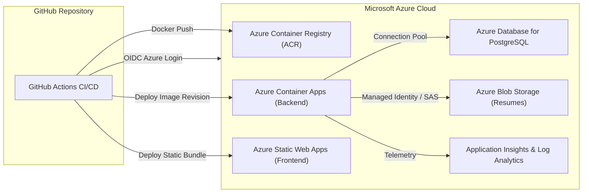

# Placera Deployment & Operations Guide

## 1. Overview & Deployment Topologies

Placera supports two primary operational topologies:
1. **Local Developer Environment**: Orchestrated via Docker Compose running PostgreSQL 16, the Spring Boot 3.3 backend, and the Nginx-hosted React frontend.
2. **Production Cloud Environment (Microsoft Azure)**: Automated via Terraform Infrastructure as Code (IaC) and GitHub Actions CI/CD workflows, utilizing Azure Container Apps (ACA), Azure Static Web Apps (SWA), Azure Database for PostgreSQL Flexible Server, Azure Blob Storage, and Azure Container Registry (ACR).

---

## 2. Local Deployment (Docker Compose)

The fastest and most isolated way to run Placera locally is through the root `docker-compose.yml`.

### 2.1 Prerequisites
- Docker Desktop 4.25+ (Engine 24+, Compose v2)
- At least 4GB of RAM allocated to Docker Engine
- Ports `80`, `8080`, and `5432` available on `localhost`

### 2.2 Step-by-Step Execution

1. **Clone the repository and copy the environment configuration**:
   ```bash
   git clone https://github.com/your-org/placera.git
   cd placera
   cp .env.example .env
   ```

2. **Review local `.env` variables**:
   ```env
   POSTGRES_DB=placera_db
   POSTGRES_USER=placera_user
   POSTGRES_PASSWORD=placera_secure_dev_pass_2026
   POSTGRES_PORT=5432

   SPRING_PROFILES_ACTIVE=dev
   JWT_SECRET=404E635266556A586E3272357538782F413F4428472B4B6250645367566B5970
   JWT_EXPIRATION_MS=86400000

   BOOTSTRAP_ADMIN_EMAIL=admin@placera.edu
   BOOTSTRAP_ADMIN_PASSWORD=AdminPassword123!

   VITE_API_BASE_URL=/api
   ```

3. **Build and launch all services**:
   ```bash
   docker compose up --build -d
   ```

4. **Verify container health**:
   ```bash
   docker compose ps
   ```
   All three containers (`placera-db`, `placera-backend`, `placera-frontend`) should indicate `healthy` status.

5. **Access the application**:
   - **Frontend Web UI**: [http://localhost](http://localhost) (or port 80)
   - **Backend REST API**: [http://localhost:8080/api](http://localhost:8080/api)
   - **Interactive Swagger UI**: [http://localhost:8080/swagger-ui/index.html](http://localhost:8080/swagger-ui/index.html)
   - **Actuator Health Probe**: [http://localhost:8080/actuator/health](http://localhost:8080/actuator/health)

6. **Tear down local environment**:
   ```bash
   # Stop containers while preserving database volume
   docker compose down

   # Stop and erase all database volumes and local uploaded resumes
   docker compose down -v
   ```

---

## 3. Cloud Deployment (Microsoft Azure)

Placera's cloud infrastructure is managed declaratively with Terraform under `infra/terraform/`.



### 3.1 Cloud Prerequisites
- Azure CLI (`az`) installed and authenticated (`az login`)
- Terraform CLI 1.5.0+ installed
- Azure Subscription (pay-as-you-go or student sponsorship)

### 3.2 Step 1: Provision Infrastructure via Terraform

1. **Navigate to the Terraform directory**:
   ```bash
   cd infra/terraform
   ```

2. **Configure your deployment parameters**:
   ```bash
   cp terraform.tfvars.example terraform.tfvars
   ```
   Edit `terraform.tfvars`:
   ```hcl
   environment        = "prod"
   azure_region       = "eastus2"
   resource_group_name = "rg-placera-prod"
   db_admin_username  = "placera_db_admin"
   db_admin_password  = "SuperSecretProdPassword2026!"
   jwt_secret         = "ReplaceWithA64ByteRandomHexSecretForProduction"
   bootstrap_admin_email    = "admin@placera.edu"
   bootstrap_admin_password = "ChangeThisAdminSecret2026!"
   ```

3. **Initialize and Validate**:
   ```bash
   terraform init
   terraform validate
   ```

4. **Review Provisioning Plan**:
   ```bash
   terraform plan -out=tfplan
   ```
   Review the resources to be created (Resource Group, ACR, ACA Environment, ACA Backend Service, PostgreSQL Flexible Server, Storage Account, Static Web App, Log Analytics).

5. **Apply Infrastructure Provisioning**:
   *(Ensure you have necessary cloud budget approval before running apply)*:
   ```bash
   terraform apply tfplan
   ```

6. **Capture Terraform Outputs**:
   ```bash
   terraform output
   ```
   Note the `backend_url`, `frontend_url`, `acr_login_server`, and `storage_account_name`.

---

## 4. Continuous Integration & Continuous Deployment (CI/CD)

The repository includes two automated workflows in `.github/workflows/`:

### 4.1 CI Workflow (`.github/workflows/ci.yml`)
- **Triggers**: On pull request and pushes to `main`.
- **Backend Job**:
  - Sets up Temurin JDK 21.
  - Caches Maven dependencies.
  - Executes unit and integration tests (`mvn clean test`).
  - Verifies multi-stage Docker build packaging.
- **Frontend Job**:
  - Sets up Node.js 20.
  - Caches npm dependencies.
  - Runs Vitest unit tests (`npm test`).
  - Runs TypeScript compilation & production build (`npm run build`).
  - Verifies multi-stage Nginx Docker build.

### 4.2 CD Workflow (`.github/workflows/deploy.yml`)
- **Triggers**: On push to `main` (only when required secrets are configured).
- **Authentication**: Uses secure OpenID Connect (OIDC) federation with Azure (`azure/login@v2`), eliminating the need to store long-lived management credentials in GitHub.
- **Backend Pipeline**:
  - Logs into Azure Container Registry (`az acr login`).
  - Builds and tags the backend image with the git commit SHA.
  - Pushes to ACR.
  - Updates the Azure Container App revision with zero-downtime rolling updates.
- **Frontend Pipeline**:
  - Builds production bundle (`npm run build`).
  - Deploys static build artifacts to Azure Static Web Apps using `Azure/static-web-apps-deploy@v1`.

### 4.3 Required GitHub Secrets

Configure the following secrets in **GitHub Repository Settings -> Secrets and variables -> Actions**:

| Secret Name | Description | Source |
| :--- | :--- | :--- |
| `AZURE_CLIENT_ID` | Client (Application) ID of Azure AD Service Principal | Azure AD App Registration |
| `AZURE_TENANT_ID` | Directory (Tenant) ID | Azure AD App Registration |
| `AZURE_SUBSCRIPTION_ID` | Azure Subscription ID | Azure Subscription |
| `AZURE_RESOURCE_GROUP` | Name of resource group | Terraform Output (`resource_group_name`) |
| `ACR_NAME` | Name of container registry | Terraform Output (`acr_login_server`) |
| `CONTAINER_APP_NAME` | Name of Azure Container App | Terraform Output (`backend_container_app_name`) |
| `AZURE_STATIC_WEB_APPS_API_TOKEN` | Deployment token for frontend SWA | Azure Portal / Terraform Output |

---

## 5. Zero-Downtime Deployment & Revisions

Azure Container Apps executes deployments via immutable **Revisions**:
1. When a new backend container image is deployed, ACA launches the new revision.
2. The `livenessProbe` and `readinessProbe` check `http://<container>:8080/actuator/health`.
3. Only after the container returns `HTTP 200` and reports status `UP` does ACA shift 100% of incoming ingress traffic to the new revision.
4. The previous revision is safely drained and decommissioned.

---

## 6. Diagnostics, Log Streaming & Rollback

### 6.1 Viewing Container Logs
To inspect real-time log streams from the running backend container app:
```bash
az containerapp logs show \
  --name ca-placera-backend-prod \
  --resource-group rg-placera-prod \
  --type console \
  --follow
```

### 6.2 Instant Rollback
If a defect is detected in a new release:
```bash
# List all revisions
az containerapp revision list \
  --name ca-placera-backend-prod \
  --resource-group rg-placera-prod \
  --output table

# Re-route 100% of traffic to the known-good previous revision
az containerapp ingress traffic set \
  --name ca-placera-backend-prod \
  --resource-group rg-placera-prod \
  --revision-weight <previous-revision-name>=100
```
