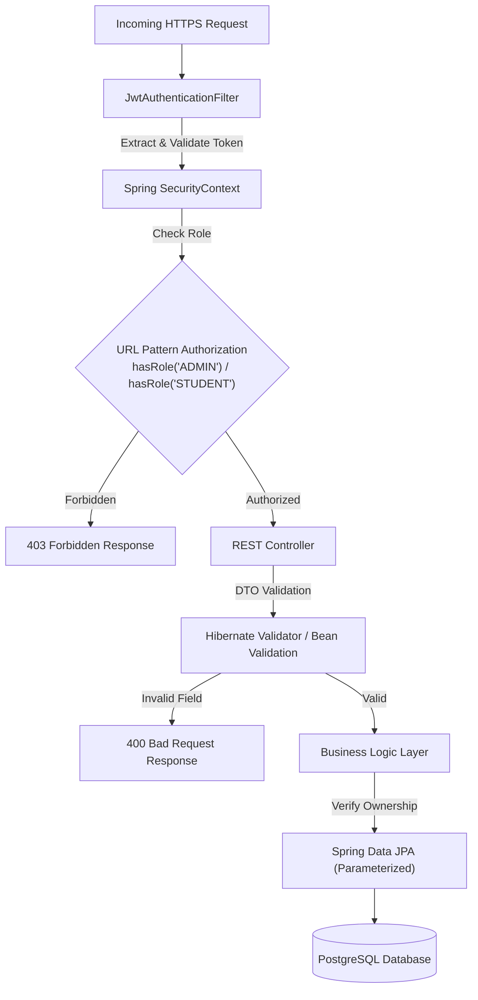

# Placera Security Architecture & Review

## 1. Executive Summary

Security is integrated into every tier of the Placera platform. As a recruitment management system handling student academic records, personal contact data, and confidential recruitment pipelines, Placera adopts a **Defense-in-Depth** and **Zero-Trust** philosophy.

---

## 2. Threat Modeling & Mitigation (STRIDE)

| Threat Category | Specific Attack Vector | Placera Architectural Countermeasure |
| :--- | :--- | :--- |
| **Spoofing** | Credential stuffing; forged authorization tokens; session hijacking. | Passwords hashed using **BCrypt** (12-round adaptive work factor). Cryptographically signed **HMAC-SHA256 (HS256)** JWT tokens with 24-hour expiration. Transport protected via TLS. |
| **Tampering** | Student artificially modifying CGPA, backlogs, or role to bypass recruitment cutoffs. | **Server-side validation**: Profile updates explicitly block modification of roles, user IDs, or application statuses. Application submission recalculates eligibility against verified database records. |
| **Repudiation** | An officer denies rejecting a student; a student denies withdrawing. | **Audit Trail & History**: Every application state change writes an immutable record to `application_status_history` and `audit_events` with actor ID, timestamp, and transition note. |
| **Information Disclosure** | Unauthorized downloading of other students' resumes or administrative analytics. | **Object-Level Authorization**: Direct storage paths are never exposed. The `/api/resumes/{id}/download` endpoint verifies that the caller is either the owner student or an authorized administrator. |
| **Denial of Service** | Exhausting server memory via multi-gigabyte file uploads or unbounded database queries. | Strict **5MB file size limit** enforced at both Nginx and Spring Boot layer. All search endpoints enforce default pagination limits (`size=20`). HikariCP manages connection thresholds. |
| **Elevation of Privilege** | Student invoking administrative endpoints (`/api/admin/**`, `/api/jobs/**` POST). | **Spring Security RBAC**: Explicit path-based authorization (`hasRole('ADMIN')`) checked at the security filter chain level before requests reach business services. |

---

## 3. Core Security Controls



### 3.1 Authentication & Credential Storage
- **Password Security**: Passwords are never stored in plaintext. They are salted and hashed using `BCryptPasswordEncoder` with an adaptive computational cost factor.
- **Stateless Tokens**: JWTs encapsulate `userId`, `email`, and `role`. The signing key is read from the `JWT_SECRET` environment variable and must be at least 256 bits (32 bytes).
- **Dual Client Token Delivery**:
  - The JWT is returned in the JSON payload for mobile or programmatic clients using `Authorization: Bearer <token>`.
  - The JWT is simultaneously set in an `HttpOnly`, `SameSite=Lax` cookie (`placera_token`) to mitigate Cross-Site Scripting (XSS) token extraction.

### 3.2 Role-Based Access Control (RBAC)
Placera implements strict role separation:
- `ROLE_STUDENT`: Permitted to view published jobs, check personal eligibility, submit/withdraw applications, upload resumes, and view assigned interviews.
- `ROLE_ADMIN`: Permitted to manage corporate partners, publish and edit job listings, review all applications, transition applicant stages, schedule interviews, access institutional analytics, and export CSV reports.
- **Default Deny**: All routes outside explicitly whitelisted public endpoints (`/api/auth/**`, `/actuator/health`, Swagger UI) require explicit authentication.

### 3.3 Resume Upload Verification & Magic Bytes Inspection
File uploads represent a high-risk attack surface. Placera implements multi-layered inspection:
1. **Extension Check**: Filename must terminate with `.pdf`.
2. **MIME Type Check**: Header must indicate `application/pdf`.
3. **Magic Bytes Binary Signature**: The server reads the leading 4 bytes of the input stream and verifies the PDF file signature (`%PDF` or hex `25 50 44 46`). Executable binaries, scripts, or images masquerading as PDFs with spoofed extensions are rejected immediately.
4. **Storage Key Sanitization**: Client-supplied filenames are never used as storage paths. Files are persisted under cryptographically random UUIDs (`UUID.randomUUID().toString() + ".pdf"`), eliminating Path Traversal (`../../`) attacks.

### 3.4 CSV Formula Injection (Spreadsheet Security)
When administrators export placement records or application rosters to CSV, user-supplied text (such as student names, project links, or skill strings) could contain malicious formulas designed to execute commands in spreadsheet software (Microsoft Excel, LibreOffice, Apple Numbers).

In `AnalyticsService.java`, all exported CSV cells are sanitized through a defense algorithm:
```java
private String escapeCsv(String value) {
    if (value == null) return "\"\"";
    // Formula Injection Mitigation: prepend single quote if cell starts with risky formula triggers
    if (value.startsWith("=") || value.startsWith("+") || value.startsWith("-") || 
        value.startsWith("@") || value.startsWith("\t") || value.startsWith("\r")) {
        value = "'" + value;
    }
    return "\"" + value.replace("\"", "\"\"") + "\"";
}
```

### 3.5 Cross-Origin Resource Sharing (CORS) & CSRF
- **CORS Configuration**: In production, CORS is restricted to authorized frontend origins (e.g. the Azure Static Web Apps custom domain). Wildcards (`*`) with credentials are strictly prohibited.
- **CSRF Strategy**: As the primary API communication operates statelessly via JWT tokens, CSRF tokens are not required for Bearer requests. For cookie authentication, browsers enforce `SameSite=Lax` policies, preventing cross-site state-changing requests from malicious third-party origins.

---

## 4. Compliance & Auditability

Placera maintains an append-only audit trail in the `audit_events` table tracking:
- User authentications and logouts.
- Job posting creations and modifications.
- Application submissions and withdrawals.
- Application status transitions with timestamp, previous stage, new stage, and administrator notes.

This guarantees compliance with institutional transparency requirements and campus accreditation audits.
