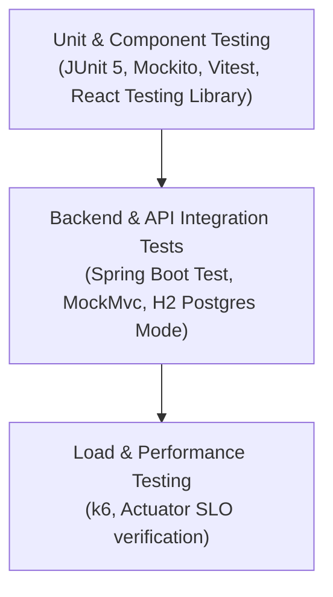

# Placera Quality Assurance & Testing Strategy

## 1. Overview & Test Pyramid

Placera employs a structured test automation strategy adhering to the classic **Test Pyramid**:



Every pull request and deployment commit is automatically validated against these testing tiers via the GitHub Actions CI pipeline.

---

## 2. Backend Automated Testing (JUnit 5 & Mockito)

Backend tests reside in `backend/src/test/java/edu/placera/` and run against an in-memory database configured for PostgreSQL emulation (`application-test.yml`).

### 2.1 Core Test Suites

#### 1. Business Logic Unit Tests (`EligibilityServiceTest.java`)
Verifies the eligibility verification engine across 5 edge-case scenarios:
- **Eligible Match**: Student with CGPA 8.75 and 0 backlogs in Computer Science matches requirements (min CGPA 7.5, max backlogs 0, CSE allowed).
- **CGPA Below Cutoff**: Student with CGPA 7.20 applying for a job requiring 7.50 is correctly rejected with a descriptive explanation.
- **Backlogs Exceed Threshold**: Student with 1 active backlog applying for a 0-backlog policy is rejected.
- **Department Ineligibility**: Mechanical Engineering student applying for a Software Engineering position restricted to CSE and IT is rejected.
- **Graduation Year Mismatch**: Student graduating in 2024 applying for a 2025/2026 drive is rejected.

#### 2. Authentication Integration Tests (`AuthControllerIntegrationTest.java`)
Verifies authentication flows and token issuance using Spring MockMvc:
- Student user registration creates database entity and returns signed JWT token.
- Duplicate email registration attempt returns `400 Bad Request` with collision details.
- Valid login returns `200 OK` and sets the `placera_token` HttpOnly cookie.
- Invalid login credentials return `401 Unauthorized` without leaking user existence.

#### 3. Recruitment Lifecycle Tests (`ApplicationWorkflowTest.java`)
Tests full state machine execution:
- Application submission creates application and records initial status history (`APPLIED`).
- Duplicate application submission triggers `DuplicateApplicationException` (`409 Conflict`).
- Admin status updates transition stages (`SHORTLISTED` -> `TECHNICAL_INTERVIEW` -> `SELECTED`) and generate real-time student notifications.

### 2.2 Running Backend Tests
Execute all backend tests via Maven:
```bash
cd backend
mvn clean test
```
To run a specific test suite:
```bash
mvn test -Dtest=EligibilityServiceTest
```

---

## 3. Frontend Component & Type Testing (Vitest & TypeScript)

Frontend tests reside in `frontend/src/test/` and utilize **Vitest** with JSDOM and `@testing-library/react`.

### 3.1 Test Suites
- **Component Integrity (`Badge.test.tsx`)**:
  - Validates styling and color classes across all badge variants (`default`, `success`, `warning`, `danger`, `info`).
  - Confirms size rendering (`sm`, `md`).
  - Verifies interactive click handlers and custom class merging.
- **Static Type Checking**: `tsc --noEmit` verifies strict TypeScript conformity, null-safety, and interface contract adherence across all pages and components.
- **Production Asset Compilation**: `vite build` verifies bundle generation, CSS tree-shaking, and asset integrity.

### 3.2 Running Frontend Tests
```bash
cd frontend

# Run unit tests
npm test

# Run tests with interactive UI
npm run test:ui

# Verify TypeScript compilation
npm run build
```

---

## 4. Performance & Load Testing (k6)

To ensure Placera can sustain peak campus placement surges (e.g., hundreds of students concurrently browsing openings and submitting resumes when a Tier-1 tech company drive opens), a reproducible **k6** load testing suite is provided in `k6/load-test.js`.

### 4.1 Service Level Objectives (SLOs) & Golden Signals
The load test measures the **Four Golden Signals**:

| Golden Signal | Metric Definition | Placera SLO Target |
| :--- | :--- | :--- |
| **Latency** | 95th Percentile (p95) response time | `http_req_duration p(95) < 250ms` |
| **Traffic** | Concurrently active simulated users | `50 Virtual Users (VUs)` ramped over 1 minute |
| **Errors** | Proportion of HTTP error responses | `http_req_failed rate < 1.0%` (0.01) |
| **Saturation** | CPU, JVM heap, and HikariCP pool | HikariCP active connections `< 80%` of max pool |

### 4.2 Simulated Load Scenarios
The k6 test executes realistic user flows:
1. Health check verification (`GET /actuator/health`).
2. Public landing page and jobs catalog retrieval (`GET /api/jobs`).
3. Student authentication simulation (`POST /api/auth/login`).
4. Student dashboard retrieval and eligibility checks (`GET /api/students/dashboard`, `GET /api/jobs/{id}/eligibility`).

### 4.3 Executing the Load Test
```bash
# Install k6 (macOS: brew install k6, Linux: apt-get install k6)
k6 run k6/load-test.js

# Target a remote staging or production instance
TARGET_URL="https://placera-backend.azurecontainerapps.io" k6 run k6/load-test.js
```

---

## 5. Test Data Management & Reproducibility

Placera features an automated `DataInitializer` component that provisions a clean, deterministic dataset on application startup whenever the database is empty:
- **1 Bootstrap Administrator**: `admin@placera.edu`
- **4 Fictional Partner Companies**: CloudScale Systems, NexaFin Tech, CyberSentinel Labs, DataMinds AI.
- **4 Sample Students**: Across Computer Science, Mechanical Engineering, Electronics, and IT.
- **4 Placement Drives**: With varied eligibility criteria (some matching, some restricted by CGPA or branch).
- **Realistic Pipeline Records**: Applications across multiple stages (`APPLIED`, `SHORTLISTED`, `HR_INTERVIEW`, `SELECTED`).
- **Scheduled Interviews & Notifications**: Demonstrates immediate end-to-end functionality without manual database seeding.
